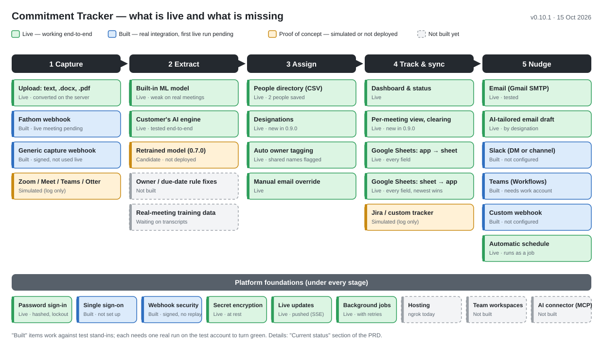

# Product Requirements Document — Commitment Tracker

**Last updated:** 2026-10-15 · **App version:** 0.10.0 · Change-by-change history: [CHANGELOG.md](CHANGELOG.md)

## Problem

Meetings generate spoken commitments ("I'll send that by Friday") that routinely get lost — no one wrote them down, no one owns following up, and there's no single place to see what's pending, in progress, or done across meetings. Existing task trackers (Jira, Sheets, etc.) require someone to manually transcribe the commitment into them, which mostly doesn't happen.

## Product concept

One local web app (Flask + SQLite; all code in `src/`, runtime data in the project root) that covers the whole loop:

1. **Capture** — a transcript arrives by upload (pasted text, `.txt`, `.docx` or `.pdf`) or by a meeting tool's signed webhook (Fathom today).
2. **Extract** — commitments (task, owner, due date, source quote) are pulled out automatically in a background job, by the built-in ML model or by an AI service the customer already pays for — whichever the account chose, for every capture path.
3. **Assign** — each owner name is matched to a real person (email, designation) from an uploaded people directory.
4. **Track & nudge** — tasks live in the app and, optionally, in the team's Google Sheet, with every field synced both ways (the most recent edit wins); owners get reminders by email, Slack, Teams or a custom webhook. Email reminders are written from the account's own draft and, optionally, tailored by AI to each recipient's designation.

The product stays **free for everyone** — no subscription or paywall language anywhere. The earlier "freemium connector inside ChatGPT/Claude" go-to-market idea remains on hold.

## Target user

Anyone who leaves meetings with verbal commitments that need follow-up — individually or in a small team — regardless of meeting platform or task tracker. Not gated behind an enterprise tier of any tool; the current test account is a personal Gmail with Zoom Basic, which shaped several choices below.

---

## Current status

### Status at a glance

*Read left to right as the product loop. Green = live and working end-to-end; blue = built with a real integration but not yet run against the real service on the test account; amber = proof of concept (simulated, or built but not deployed); grey dashed = not built. Totals: 13 live, 12 built and awaiting a first live run, 3 proof of concept, 5 not built. Regenerate with `python src/docs_tools/make_status_diagram.py` when a status changes.*

Legend for the tables below — **Verified live:** exercised against the real external service. **Verified with stand-ins:** the real code path was tested against local stand-ins for the external service (fake SMTP server, local webhook receivers, stubbed Google API), not the service itself.

### 1. Built, with a real integration

| Capability | How it works | Verified | What it needs to use |
|---|---|---|---|
| Transcript upload (0.9.0: `.docx` / `.pdf`) | Paste text, or upload `.txt`, `.docx` (Word, incl. speaker/text tables) or `.pdf` with a text layer, up to 20 MB. Files are converted to text on the server, then go through exactly the same extraction as pasted text. Scanned PDFs, old `.doc` files and renamed files are refused with a clear reason | Live (FY2027 `.docx`, PRD `.pdf`) | Nothing (`pypdf` is already a requirement) |
| Transcript formats | `Name: text`, `[10:00 AM] Name:` header lines, `[09:00] Name: text`, WebVTT/SRT captions, curly quotes, "ACTION ITEMS" sections | Live (team's files) | Nothing |
| Commitment extraction — built-in model | Sentence-embedding classifier + owner/task/due-date rules, runs locally | Live | ML libraries + trained model (installed on this machine). **Quality is limited — see Data & ML** |
| Commitment extraction — customer's AI | Per-account engine: Claude (Anthropic SDK) or any OpenAI-compatible API (OpenAI, Azure OpenAI, Gemini, Groq, Ollama). **Applies to every capture path** — pasted text, uploaded `.txt`/`.docx`/`.pdf` files, webhooks and re-extraction — not only Fathom; the upload result and the Background jobs page name the engine that ran. Falls back to built-in on any failure (also shown); side-by-side comparison + scoreboard | Claude: wiring verified, live call only with an invalid key. OpenAI-compatible: stand-in + Ollama cloud model live on a sample. **Gemini 2.5 Pro is configured on the test account but no meeting has run through it yet** | Customer's API key (chat subscriptions don't include API access). Optional feature with an off switch (`AI_EXTRACTION_ENABLED=0`) and a revert script — built on trial pending team review |
| Fathom → app (live transcripts) | Signed webhook (`/api/webhooks/fathom/<token>`, HMAC-verified; since 0.9.0 also a 5-minute timestamp window and one-time delivery ids against replays); speaker turns used directly; extraction runs as a background job so Fathom gets a fast reply | Stand-ins (synthetic signed payload) — **not yet with a live Fathom meeting** | Free Fathom account, its bot in the meeting, ngrok (installed) or hosting, webhook secret saved in Integrations |
| Generic transcript webhook | `/api/webhooks/transcript-capture/<token>` for any tool that can POST JSON — **must be HMAC-signed** with the account's signing secret (0.9.0) | Stand-ins | Public URL (ngrok) + the signing secret |
| Google Sheets — app → sheet | Real Sheets API; rows written to columns A:F (ID, Task, Owner, Due date, Status, Owner email) with a header; auto-sync of new commitments and **every edit** (task, owner, owner email, due date, status — 0.10.0); bulk "Sync all to sheet" | Live (test account's sheet, rows written); fixes in 0.3.1/0.4.0 verified with stand-ins | One-time Google login (done on this machine). **Auto-sync is currently OFF on the test account** — re-save the tracker settings to turn it on |
| Google Sheets — sheet → app | Apps Script `onEdit` trigger → **signed** `/api/webhooks/tracker-update/<token>` (0.9.0; the old unsigned URL answers 410). Since 0.10.0 **every field** syncs back (task, owner, owner email, due date, status; Done/Closed/In progress/Open… accepted); an owner without an email is matched from People. **Most recent edit wins:** an edit older than the app's last change is ignored and the row is restored to the app's version | Stand-ins; **not yet re-confirmed from the real sheet** | Apps Script with installable trigger (**replace any earlier script with the 0.10.0 one on the Integrations page**), the signing secret, current ngrok URL |
| People directory & owner tagging | CSV upload (First/Last Name, Email ID, Corporate User Name, **Designation** — 0.9.0); every new task auto-tagged; shared names flagged, never guessed; manual override; designation editable per person | Stand-ins + test DB | Upload a people CSV (2 people on the test account, no designations yet) |
| Nudges — email | SMTP (Gmail app password, Microsoft 365, SendGrid…) to the owner's email | Stand-in SMTP server — **not yet sent through real Gmail** | SMTP details (an email channel is saved on the test account) |
| Email draft + AI tailoring (0.9.0) | The account writes one reminder draft with placeholders (`{owner_first_name}`, `{task}`, `{due_date}`, `{meeting}`…). With AI tailoring on, each email is rewritten for the recipient's designation — brief and outcome-focused for executives, clear next steps for individual contributors, more guidance for interns — keeping every fact and ask. Uses the AI extraction page's engine and key; any AI problem sends the draft as written. Preview on the Integrations page | Stand-in AI engine; preview live with AI off | Draft (optional — a default exists), designations on People, an AI engine on the AI extraction page |
| Nudges — Slack | Bot token → direct message (looked up by email), or webhook → channel | Stand-ins | Free Slack app; not configured |
| Nudges — Teams | Power Automate Workflows webhook (channel post, or DM via a custom flow) | Stand-ins | **Microsoft 365 work/school account** (personal Teams can't) |
| Nudges — custom | JSON POST of recipient/task/due/status to any URL | Stand-ins | A URL |
| Automatic nudges | Every 15 min while the app runs, as a background job per account: day-before / on-due / daily-overdue, no repeats, finished tasks skipped | Live (job ran on a copy of the test DB; nothing was due) | Off by default; switch on in Integrations |
| AI-suggested setup steps for custom apps | Claude call when `ANTHROPIC_API_KEY` is set, template otherwise | Template path live | Optional API key |
| Secret encryption (0.8.0) | Every saved credential (AI API keys, SMTP password, Slack/Teams/custom webhook URLs and tokens, Jira token, Zoom/Fathom secrets) is Fernet-encrypted in the database. It is never returned to the browser in full; the browser sees only a masked hint, and a blank field on save keeps the stored value. An older database is encrypted automatically on first start, after a backup copy is made | Live (local, tests + migrated copy of the test DB) | Nothing. **Back up `secret.key`** (or set `COMMITMENT_TRACKER_SECRET_KEY`): without it, saved credentials must be re-entered |
| Real sign-in (0.9.0) | Email + password (salted scrypt hash, lockout after 5 failures for 15 min, the same message for a wrong email or password), or single sign-on with any OpenID Connect provider (Google, Microsoft Entra ID, Okta, Auth0, Keycloak — authorization code + PKCE, state and nonce, issuer / audience / expiry / verified-email checks, optional allowed email domains). HttpOnly SameSite session cookie with a generated signing key; a password change or "sign out everywhere" ends all other sessions; CSRF header required on every change; app pages redirect when signed out; Account page | Live (browser, copy of the test DB); SSO with a stand-in identity provider | Accounts from before 0.9.0 have no password: `python src/manage_users.py set-password <email>`, or sign in with SSO. SSO needs an OAuth app per provider in `auth_config.json` |
| Webhook security (0.9.0) | Per-account signing secret (encrypted at rest; reveal / copy / rotate on the Integrations page); HMAC-SHA256 over `timestamp.body`; 5-minute window; replayed deliveries refused; 60 requests/min per webhook URL; every delivery logged and listed | Tests (signature, tampering, replay, stale timestamp, rate limit) | Senders must sign — Apps Script and Python examples on the Integrations page |
| Background jobs (0.9.0) | Persistent queue in SQLite with one worker thread: extraction after an upload or webhook, retries of failed Google Sheets syncs, automatic nudges. Retries with exponential backoff; permanent failures reported at once; jobs survive a restart. Background jobs page with retry / cancel; the dashboard shows "Extracting…" and updates live | Live (`.docx` and `.pdf` extracted on a copy of the test DB) | Nothing. One app process, like live updates. First extraction after a start is slow (several minutes on this machine) while the model loads |
| Per-meeting view and clearing (0.9.0) | The dashboard shows one selected meeting's tasks (or all). Clear one meeting's tasks, all tasks, one meeting, or all meetings, each with a confirmation. Rows already in the Google Sheet are not touched | Live (browser) | Nothing |
| Live dashboard updates (0.8.0) | Server-Sent Events (`/api/events`). New meetings (upload or webhook), status changes (in-app or from the Sheet) and sent nudges appear in open dashboards and the Integrations activity logs immediately, with no refresh. If the stream is unavailable, the page falls back to polling every 8 s | Live (real threaded server, webhook → open stream in ~0.05 s) | Nothing. Single app process only; several worker processes would need a shared broker (e.g. Redis) |

### 2. Built as proof of concept — no real integration

| Capability | What exists | What's missing |
|---|---|---|
| Jira tracker | Settings form, mocked "would create issue" outbound log; inbound status webhook is real code | Real Jira API calls; never tested with a real Jira automation |
| Custom tracker | Settings form, mocked outbound | Any real call |
| Zoom / Google Meet / Teams / Otter as transcript sources | Settings forms, setup steps, mocked "Check now" | Real APIs. Not usable on the test account anyway: Zoom Basic has no cloud transcripts, Meet's transcript API needs Google Workspace, Otter's API is Enterprise-only — Fathom is the working route |
| Retrained model | `ml/action_detector_candidate.keras` (fewer false positives, more misses) | Not deployed — regressed on the only business meeting (see Data & ML) |
| Demo / simulate buttons | Demo meetings, "Simulate incoming transcript", "Simulate update from tracker" | — (test aids, by design) |

### 3. Not built

- Multi-user team workspaces — every meeting still belongs to one account (sign-in is real since 0.9.0; sharing isn't).
- Hosting — inbound webhooks only reach the app through ngrok, whose free URL changes on restart. Jobs and live updates run inside the one app process; several processes would need a shared queue and broker.
- Email verification for password sign-up, password reset by email, and multi-factor sign-in (an SSO provider can enforce MFA itself).
- OCR for scanned PDFs.
- An AI-assistant connector (MCP server / GPT Action).
- Mobile / native clients (the sidebar is hidden on narrow screens).

---

## Data & ML status

- **Built-in model** was trained only on synthetic, templated meetings (99.99% on that data, which says little). On the real-format FY2027 meeting it finds 10 of 13 commitments but flags 25 false ones.
- **0.7.0 retraining** used the team's transcripts, which turned out to be ~5 independent sources: two templates repeated hundreds of times, two AI-rewritten workshops, one real recording that is a class lecture — and **no real business meetings**. Leave-one-family-out results: average F1 0.24 → 0.44, but FY2027 0.42 → 0.38 (finds 4 of 13). Not deployed.
- **Labels** for 2,996 distinct lines (158 commitments) are in `training_data/labelled_utterances.csv` (labelling script: `src/ml/labels.py`) with borderline calls noted — **awaiting team review**.
- **Owner and due-date extraction** is rule-based and misses common shapes: read-out assignment lists ("Kevin Heys (Due: September 27): …") are credited to the reader, and "Due: September 26" / "end of this month" aren't parsed.
- **Next data needed:** 5–10 real business-meeting transcripts (Fathom recordings are the easiest source) — the team is collecting these.

## Source control

- 0.8.0–0.10.0 are committed on branch `release/v0.10.0` (not pushed yet). Credentials and keys are git-ignored; the FY2027 transcripts (real meeting content) were taken out of tracking in that commit — they remain in earlier, already-pushed commits.
- **Layout (0.9.0):** all code is in `src/` — the app modules, `static/`, `schema.sql`, `tests/`, `ml/` training scripts and `docs_tools/`. Runtime data stays in the project root: the database, `secret.key`, `flask_secret.key`, Google credentials, `auth_config.json`, and the models in `ml/`.
- Excluded from git on purpose: the local database, `secret.key`, `flask_secret.key`, `auth_config.json`, Google credentials (`client_secret_*.json`, `google_token.json`), embedding cache, `_snapshots/`.
- Not excluded and needing a decision before any commit: training CSVs (~21 MB), the team's transcript folder (~7 MB), FY2027 transcript files (real meeting content), the original Colab script.

## Key user stories

1. As someone who just left a meeting, I want the commitments that came out of it in one place, without typing them in.
2. As a commitment owner, I want to mark my task pending / in progress / done, and see whether it's overdue.
3. As a user whose team lives in a Google Sheet, I want commitments to appear there automatically and every change — task, owner, email, due date, status — to flow both ways, with the latest edit winning.
4. As an owner, I want a reminder before my deadline, on the channel my team already uses.
5. As the person running the meeting, I want each task tagged with the right person's email automatically — and to fix it when two people share a name.
6. As a company with an AI subscription, I want to use that AI for extraction and compare it with the built-in model before switching.
7. As a user, I want to sign in with my company account (SSO) or a password, so nobody can open my meetings just by knowing my email.
8. As someone picking an unfamiliar setting (a Slack token, an SMTP app password), I want the app to tell me where to get it — and to see what I've already saved when I come back.
9. As a manager, I want to write the reminder email once and have it read right for a VP and for an intern.
10. As a user with many meetings, I want to see one meeting's tasks at a time and clear out old meetings or tasks.
11. As someone whose transcripts are Word or PDF files, I want to upload them as they are.

## Open questions / decisions

- **Model:** keep the current built-in model or switch to the 0.7.0 candidate until real meetings arrive? (Recommendation: keep current.)
- **Trial feature:** keep or revert the 0.5.0 AI-extraction feature after team review.
- **Labels:** does the team agree with the commitment definition used for labelling?
- **Git:** when to commit, and which of the large/sensitive files above belong in the repository.
- **Hosting** — and with it whether to stay on SQLite + one process, or move to Postgres + a shared job queue.
- **SSO provider** for the team (Google Workspace, Microsoft Entra ID, Okta…), and whether to turn off open sign-up (`allow_signup: false`).
- **Connector platform** (MCP, GPT Action, both, neither) — still on hold.

## Roadmap (proposed order)

1. ~~Local prototype: dashboard, tracker/nudge settings, chart~~ — done (0.1.0).
2. ~~Built-in commitment extraction~~ — done (0.2.0), quality work ongoing.
3. ~~Real Fathom capture and two-way Google Sheets sync, auto-sync~~ — done (0.3.0–0.4.0).
4. ~~Optional customer-AI extraction with comparison~~ — done on trial (0.5.0).
5. ~~People directory, owner tagging, real nudges~~ — done (0.6.0).
6. ~~Retraining pipeline and parsing fixes~~ — done (0.7.0); model not yet improved enough to deploy.
7. ~~Secret encryption, live dashboard updates~~ — done (0.8.0). ~~Real sign-in / SSO, webhook security, background jobs, `.docx`/`.pdf` upload, AI-tailored email drafts, designations, per-meeting view and clearing~~ — done (0.9.0). ~~Full two-way Sheet sync of every field, most recent edit wins~~ — done (0.10.0).
8. **Next, no new data needed:** rule fixes for assignment lists and due-date phrases; email verification and password reset; OCR for scanned PDFs.
9. **Next, with real transcripts:** label (with team review), retrain, evaluate on held-out real meetings, decide deployment.
10. Go-live checks on the test account: set a password (`manage_users.py`), one real Fathom meeting, one real Gmail nudge with an AI-tailored draft, a sheet → app edit through the new 0.10.0 Apps Script.
11. Hosting decision → team workspaces → connector.
